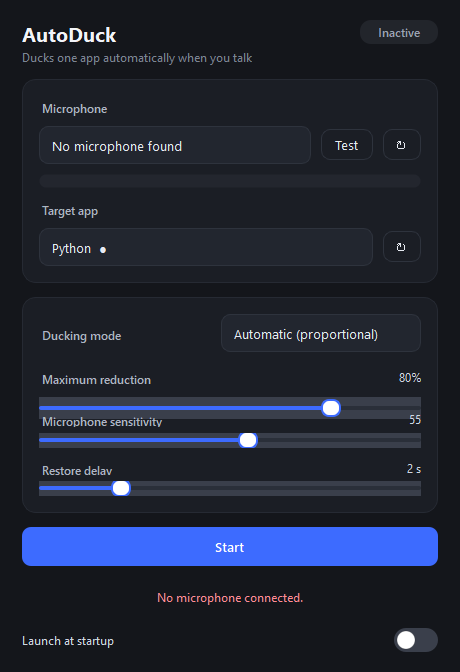
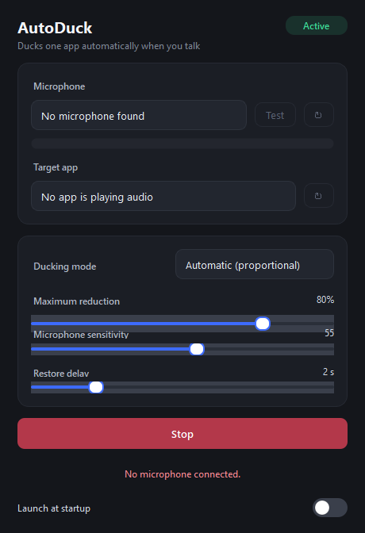

<div dir="rtl">

# AutoDuck

**کاهش خودکار و هوشمند صدای یک برنامه، بر اساس تشخیص صدای میکروفون.**

وقتی شروع به صحبت می‌کنید، AutoDuck صدای **یک برنامه‌ی انتخابی** را کم می‌کند و پس از پایان صحبت آن را به سطح قبلی برمی‌گرداند — درست مثل کاری که یک صداساز حرفه‌ای با موسیقی زیر صدای گوینده انجام می‌دهد، با این تفاوت که کاملاً خودکار است. فقط صدای همان برنامه‌ی انتخاب‌شده تغییر می‌کند؛ حجم صدای کل سیستم و سایر برنامه‌ها دست‌نخورده می‌ماند.

[English](README.md) | **فارسی**



<p align="center"><em>حالت فعال:</em></p>



---

## امکانات

- **دو حالت کاهش صدا**
  - **خودکار (متناسب):** هرچه صدای میکروفون بلندتر باشد، صدای برنامه بیشتر کم می‌شود. با قطع کامل صدا، حجم به مقدار اولیه برمی‌گردد.
  - **ثابت (درصدی):** مثلاً ۵۰٪ ← هنگام صحبت، صدای برنامه دقیقاً روی نصف حجم اولیه نگه داشته می‌شود.
- **کنترل در سطح هر Session صوتی با Windows Audio Session API (WASAPI)** — فقط Session برنامه‌ی انتخابی تغییر می‌کند، هرگز صدای کل سیستم.
- **حساسیت قابل تنظیم** و **حداکثر میزان کاهش**.
- **تأخیر بازگشت صدا (Hold):** پس از قطع صحبت، صدا برای مدت قابل تنظیم (۰ تا ۱۰ ثانیه) پایین می‌ماند و سپس نرم بازمی‌گردد؛ این‌طور مکث‌های کوتاه وسط جمله باعث بالا-پایین شدن آزاردهنده‌ی صدا نمی‌شوند.
- **نمایشگر لحظه‌ای شدت صدای میکروفون** به‌همراه دکمه‌ی **تست میکروفون** داخل برنامه.
- **فهرست خودکار برنامه‌ها** (بدون نیاز به Refresh دستی): با شروع، توقف و بسته شدن برنامه‌ها، Sessionها اضافه/حذف می‌شوند و نامشان به‌روز می‌شود.
- **حفظ انتخاب کاربر بر اساس هویت واقعی Session** — بنابراین Refresh شدن فهرست یا تغییر نام‌ها، انتخاب شما را از بین نمی‌برد.
- **نرم‌سازی Attack/Release** برای جلوگیری از پرش و کلیک صدا.
- **بازگردانی خودکار صدا** هنگام توقف، خروج، قطع میکروفون یا بسته شدن برنامه‌ی هدف — حجم اولیه همیشه برگردانده می‌شود.
- **چرخه‌ی عمر مقاوم:** اگر پردازش صدا خطا بدهد، دکمه‌ها به حالت اولیه برمی‌گردند و برنامه گیر نمی‌کند.
- پشتیبانی از **سینی سیستم (System Tray)** و گزینه‌ی اختیاری **اجرای خودکار با ویندوز**.
- رابط کاربری **تیره و مینیمال**.

---

## پیش‌نیازها

- ویندوز ۱۰ یا ۱۱ (۶۴ بیتی)
- پایتون ۳.۱۰ یا بالاتر (برای اجرا از سورس)

## نصب و اجرا (از سورس)

```bash
python -m pip install -r requirements.txt
```

```bash
python main.py
```

## ساخت فایل EXE مستقل

```bash
python -m PyInstaller AutoDuck.spec --noconfirm
```

خروجی: `dist\AutoDuck\AutoDuck.exe` (کل پوشه‌ی `dist\AutoDuck` را جابه‌جا کنید).
یا به‌سادگی اجرا کنید:

```bash
build.bat
```

---

## راهنمای استفاده

۱. یک **میکروفون** انتخاب کنید. با دکمه‌ی **Test** مطمئن شوید که با صحبت کردن، نوار شدت صدا پر می‌شود؛ دکمه‌ی **↻** فهرست دستگاه‌ها را دوباره می‌خواند.
۲. **برنامه‌ی هدف** را انتخاب کنید (همان برنامه‌ای که باید صدایش کم شود). علامت **●** یعنی این Session همین حالا صدا پخش می‌کند. دکمه‌ی **↻** فهرست را به‌اجبار به‌روز می‌کند.
۳. یک **حالت کاهش صدا** انتخاب کنید:
   - **Automatic** — با لغزنده‌ی **Maximum reduction** بیشترین میزان کاهش را تعیین کنید.
   - **Fixed** — با لغزنده‌ی **Reduction amount** مقدار ثابت را تعیین کنید.
۴. **Microphone sensitivity** (بالاتر = با صدای آهسته‌تر هم فعال می‌شود) و **Restore delay** را تنظیم کنید.
۵. دکمه‌ی **Start** را بزنید. نشانگر وضعیت به **Active** تغییر می‌کند.
۶. برای بازگرداندن فوری صدای اولیه، **Stop** را بزنید.

**سینی سیستم:** بستن پنجره، برنامه را نمی‌بندد و AutoDuck در سینی سیستم (کنار ساعت) فعال می‌ماند. برای خروج کامل، روی آیکن سینی راست‌کلیک کنید و **Quit** را بزنید.

**اجرای خودکار:** سوییچ **Launch at startup** را روشن کنید تا هنگام ورود به ویندوز اجرا شود (کلید Run کاربر جاری، بدون نیاز به دسترسی ادمین).

---

## تنظیم دقیق

| پارامتر | محل | توضیح |
|---|---|---|
| حالت کاهش | فهرست Ducking mode | Automatic یا Fixed |
| میزان کاهش | لغزنده (حالت Fixed) | ۰ تا ۱۰۰ درصد |
| حداکثر کاهش | لغزنده (حالت Automatic) | ۱۰ تا ۱۰۰ درصد |
| حساسیت | لغزنده (هر دو حالت) | آستانه‌ی فعال‌سازی؛ پیش‌فرض ۵۵ |
| تأخیر بازگشت | لغزنده (هر دو حالت) | ۰ تا ۱۰ ثانیه؛ مدت پایین ماندن صدا پس از قطع صحبت |

مقادیر Attack و Release به‌صورت داخلی روی ۴۰ms و ۳۲۰ms تنظیم شده‌اند و نیازی به تغییر ندارند.

---

## رفع اشکال

| مشکل | راه‌حل |
|---|---|
| میکروفون در فهرست نیست | دستگاه را وصل کنید و ↻ را بزنید؛ در ویندوز مسیر Settings → Privacy → Microphone را فعال کنید. |
| برنامه‌ی هدف در فهرست نیست | برنامه باید **در حال پخش صدا** باشد تا Session آن ساخته شود؛ سپس ↻ را بزنید. |
| پیام «Target app is not playing audio…» | Session انتخاب‌شده بی‌صدا شده یا بسته شده است. |
| صدا تغییر نمی‌کند | کنترل روی *Session صوتی* برنامه اعمال می‌شود، نه روی کلید بی‌صدا (Mute) خود برنامه. برنامه‌هایی که از WASAPI استفاده نمی‌کنند ممکن است در فهرست ظاهر نشوند. |
| برنامه بسته نمی‌شود | پنجره فقط به سینی پنهان می‌شود؛ از منوی سینی **Quit** را بزنید. |
| نام تب مرورگر نمایش داده نمی‌شود | ویندوز صدای همه‌ی تب‌های یک مرورگر را در **یک** Session ادغام می‌کند و API عمومی برای تفکیک هر تب وجود ندارد؛ بنابراین AutoDuck نام خود برنامه را نشان می‌دهد و نام تب را حدس نمی‌زند. |

---

## معماری

```
main.py                     نقطه‌ی ورود Qt
autoduck/
  ducking.py                منطق خالص کاهش صدا (بدون وابستگی به ویندوز، تست‌پذیر)
  sessions.py               شمارش و کنترل حجم هر Session (pycaw/WASAPI)
  audio_watch.py            رصد زنده‌ی Sessionها (IAudioSessionEvents + diff سبک)
  engine.py                 ضبط میکروفون + حلقه‌ی کنترل (رشته‌ی COM اختصاصی)
  main_window.py            رابط کاربری PySide6
  widgets.py                نوار شدت صدا و سوییچ سفارشی
  autostart.py              اجرای خودکار با ویندوز از طریق کلید Run در HKCU
tests/
  test_ducking.py           آزمون‌های منطق کاهش صدا
  test_engine_lifecycle.py  آزمون‌های رگرسیون شروع/توقف
  test_sessions_live.py     آزمون زنده‌ی کنترل حجم Session
  test_engine_e2e.py        آزمون سرتاسری موتور با میکروفون ساختگی
docs/
  screenshot.png            اسکرین‌شات رابط (غیرفعال)
  screenshot-active.png     اسکرین‌شات رابط (فعال)
```

**مدل رشته‌ها (Threading):** ضبط صدا روی رشته‌ی PortAudio انجام می‌شود و فقط RMS را محاسبه می‌کند. یک رشته‌ی کاری واحد، حلقه‌ی کنترل ۶۰Hz را با آپارتمان COM مخصوص خودش اجرا می‌کند و تنها مالک چرخه‌ی عمر برنامه است. رشته‌ی رابط کاربری فقط `start` / `stop` / `update` را صدا می‌زند و به‌روزرسانی‌ها را از طریق سیگنال‌های Qt دریافت می‌کند؛ بنابراین رابط هیچ‌وقت مسدود نمی‌شود و امکان اجرای دو پردازش همزمان وجود ندارد.

**به‌روزرسانی فهرست برنامه‌ها:** رصدگر روی رشته‌ی COM اختصاصی خودش با یک Message Pump اجرا می‌شود. برای هر Session یک sink از `IAudioSessionEvents` ثبت می‌شود تا تغییر وضعیت/نام فوراً برسد؛ یک diff سبک هر ۲ ثانیه هم Sessionهای کاملاً جدید را می‌گیرد. نتایج از طریق سیگنال Qt به رابط می‌رسند، پس هیچ شمارش صوتی روی رشته‌ی GUI انجام نمی‌شود.

---

## آزمون‌ها

```bash
python tests/test_ducking.py
```

```bash
python tests/test_engine_lifecycle.py
```

آزمون‌های زنده به برنامه‌ای نیاز دارند که همین حالا صدا پخش کند (مثلاً ابتدا یک پخش‌کننده‌ی موسیقی را اجرا کنید):

```bash
python tests/test_sessions_live.py
```

```bash
python tests/test_engine_e2e.py
```

---

## مصرف منابع

- مصرف CPU در حالت فعال: معمولاً به‌طور محسوس زیر ۱٪ (حلقه‌ی کنترل ۶۰Hz).
- مصرف RAM: حدود ۱۲۰ تا ۱۸۰ مگابایت (بیشتر مربوط به PySide6).
- پردازش صدا به‌صورت بلوکی و بدون بافر انباشتی است؛ تأخیر تشخیص در حدود چند ده میلی‌ثانیه.

## محدودیت‌ها

- فقط برنامه‌هایی که از Session صوتی WASAPI استفاده می‌کنند قابل کنترل هستند.
- کنترل روی **حجم Session** اعمال می‌شود؛ اگر خودتان در همان لحظه حجم برنامه را تغییر دهید، تغییر شما اعمال می‌شود.
- بدون میکروفون، موتور شروع نمی‌شود (دکمه‌ی Start غیرفعال است).
- **تب‌های مرورگر:** ویندوز صدای همه‌ی تب‌های یک مرورگر را در یک Session ادغام می‌کند و API عمومی برای تفکیک تب‌ها ارائه نمی‌دهد؛ بنابراین نام خود برنامه (مثلاً «Microsoft Edge») نمایش داده می‌شود، نه عنوان هر تب — هیچ نام تبی حدس زده نمی‌شود.
- `GetDisplayName` اغلب خالی است؛ در آن صورت AutoDuck از **FileDescription** فایل اجرایی (نام محصول خوانا) و در نهایت از نام مرتب‌شده‌ی پردازش استفاده می‌کند.
- رویداد `OnSessionCreated` در سطح مدیر از روی COM پایتون به‌طور مطمئن فراخوانی نمی‌شود؛ بنابراین Sessionهای جدید با یک diff سبک هر ۲ ثانیه شناسایی می‌شوند، نه با Polling سنگین.

---

## مجوز

MIT — فایل [LICENSE](LICENSE) را ببینید.

</div>
