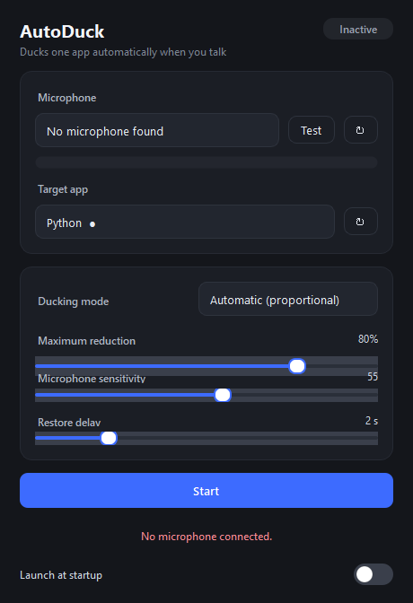
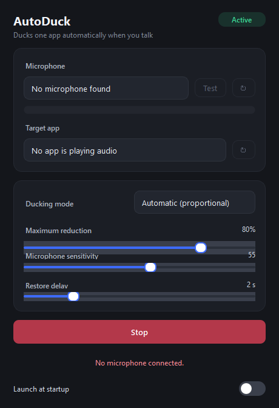

# AutoDuck

**Automatic per-app volume ducking driven by your microphone.**

**English** | [فارسی](README.fa.md)

When you start talking, AutoDuck lowers the volume of *one app you choose* and
lifts it back afterwards — like a producer ducking the music under a voice-over,
except it happens on its own. Only the selected app is touched; system volume
and every other application stay exactly as they were.



<p align="center"><em>Active state:</em></p>



---

## Features

- **Two ducking modes**
  - **Automatic (proportional):** the louder your mic, the more the volume drops.
    Absolute silence restores the original level.
  - **Fixed (percentage):** e.g. 50% → while you speak the target is held at
    exactly half its original volume.
- **Per-session control via the Windows Audio Session API (WASAPI)** — only the
  chosen app's session is changed, never system-wide volume.
- **Adjustable sensitivity** and **maximum reduction**.
- **Restore delay (hold):** after you stop talking the volume stays down for a
  configurable time (0–10 s) before easing back, so short pauses don't make the
  background pump up and down.
- **Live input-level meter** with an in-app **microphone test** button.
- **Automatic app list** (no manual refresh needed): sessions appear/disappear
  and update their names as apps start, stop and close.
- **Selection kept by real session identity**, so refreshing or renaming never
  loses your choice.
- **Attack/release smoothing** to avoid clicks and oscillation.
- **Automatic restore** on stop, quit, microphone unplug, or when the target app
  closes — the original volume is always put back.
- **Resilient lifecycle:** if audio processing fails, the button resets itself
  instead of leaving the app stuck.
- **System tray** support and optional **launch at startup**.
- **Dark, minimal UI.**

---

## Requirements

- Windows 10 or 11 (64-bit)
- Python 3.10+ (to run from source)

## Install & run (from source)

```bash
python -m pip install -r requirements.txt
```

```bash
python main.py
```

## Build a standalone EXE

```bash
python -m PyInstaller AutoDuck.spec --noconfirm
```

Output: `dist\AutoDuck\AutoDuck.exe` (ship the whole `dist\AutoDuck` folder).
Or simply run:

```bash
build.bat
```

---

## Usage

1. Pick a **microphone**. Use **Test** to confirm the level meter moves when you
   speak; **↻** re-scans the device list.
2. Pick the **target app** (the one whose audio should be lowered). A **●** marks
   a session that is currently playing. **↻** forces a refresh.
3. Choose a **ducking mode**:
   - **Automatic** — set **Maximum reduction**.
   - **Fixed** — set **Reduction amount**.
4. Adjust **Microphone sensitivity** (higher = triggers on quieter speech) and
   **Restore delay**.
5. Press **Start**. The status pill turns to **Active**.
6. Press **Stop** to restore the original volume immediately.

**Tray:** closing the window keeps AutoDuck running in the system tray so ducking
survives. Right-click the tray icon → **Quit** to exit fully.

**Startup:** toggle **Launch at startup** to run at login (per-user registry, no
admin required).

---

## Tuning

| Parameter | Where | Meaning |
|---|---|---|
| Ducking mode | Mode dropdown | Automatic or Fixed |
| Reduction amount | Slider (Fixed mode) | 0–100 % |
| Maximum reduction | Slider (Automatic mode) | 10–100 % |
| Sensitivity | Slider (both modes) | Trigger threshold; default 55 |
| Restore delay | Slider (both modes) | 0–10 s; how long the volume stays down after speech ends |

Attack and release are fixed internally at 40 ms and 320 ms and need no tuning.

---

## Troubleshooting

| Problem | Fix |
|---|---|
| No microphone listed | Connect it and press ↻; in Windows enable Settings → Privacy → Microphone. |
| Target app not listed | The app must be **playing audio** for its session to exist; then press ↻. |
| "Target app is not playing audio…" | The selected session went quiet or closed. |
| Volume doesn't change | Control is applied to the app's *audio session*, not the app's own mute button. Apps that don't use WASAPI may not appear. |
| App won't close | The window only hides to the tray; use the tray menu → **Quit**. |
| Browser tab name not shown | Windows merges all of a browser's audio into **one** session; there is no public per-tab Core Audio API, so AutoDuck shows the app name rather than guessing a tab title. |

---

## Architecture

```
main.py                     Qt entry point
autoduck/
  ducking.py                Pure ducking math (no Windows deps, unit-tested)
  sessions.py               Per-session enumeration & volume control (pycaw/WASAPI)
  audio_watch.py            Live session tracking (IAudioSessionEvents + light diff)
  engine.py                 Mic capture + control loop (dedicated COM thread)
  main_window.py            PySide6 UI
  widgets.py                Level meter and toggle switch
  autostart.py              Run-at-login via HKCU Run key
tests/
  test_ducking.py           Ducking math tests
  test_engine_lifecycle.py  Start/stop regression tests
  test_sessions_live.py     Live per-session volume test
  test_engine_e2e.py        End-to-end engine test with a synthetic mic
docs/
  screenshot.png            UI screenshot (idle)
  screenshot-active.png     UI screenshot (active)
```

**Threading:** audio capture runs on the PortAudio thread and only computes an
RMS level. A single worker thread runs the 60 Hz control loop (with its own COM
apartment) and is the sole owner of the running lifecycle. The UI thread only
calls `start` / `stop` / `update` and receives updates through Qt signals, so the
interface never blocks and can never run two workers at once.

**App list refresh:** the watcher runs on its own COM thread with a message pump.
Each session gets an `IAudioSessionEvents` sink so state/name changes arrive
immediately; a light 2-second snapshot diff catches brand-new sessions. Results
reach the UI via a Qt signal, so no audio enumeration ever happens on the GUI
thread.

---

## Tests

```bash
python tests/test_ducking.py
```

```bash
python tests/test_engine_lifecycle.py
```

Live tests need an app that is currently playing audio (e.g. start any media
player first):

```bash
python tests/test_sessions_live.py
```

```bash
python tests/test_engine_e2e.py
```

---

## Resource use

- CPU when active: typically well under 1 % (60 Hz control loop).
- RAM: roughly 120–180 MB (mostly PySide6).
- Audio is processed block-wise with no accumulating buffer; detection latency is
  on the order of tens of milliseconds.

## Limitations

- Only apps that use WASAPI audio sessions can be controlled.
- Control acts on the **session volume**; if you change the app's volume at the
  same moment, your change wins.
- Without a microphone the engine can't start (the Start button is disabled).
- **Browser tabs:** Windows merges all tabs of a browser into one audio session,
  and exposes no public per-tab API, so the app (e.g. "Microsoft Edge") is shown
  instead of individual tab titles — no tab name is guessed.
- `GetDisplayName` is often empty; AutoDuck then uses the executable's
  **FileDescription** (friendly product name) and finally a tidied process name.
- The manager-level `OnSessionCreated` event does not reliably fire from Python's
  COM stack, so new sessions are detected by a light 2-second diff rather than
  heavy polling.

---

## License

MIT — see [LICENSE](LICENSE).